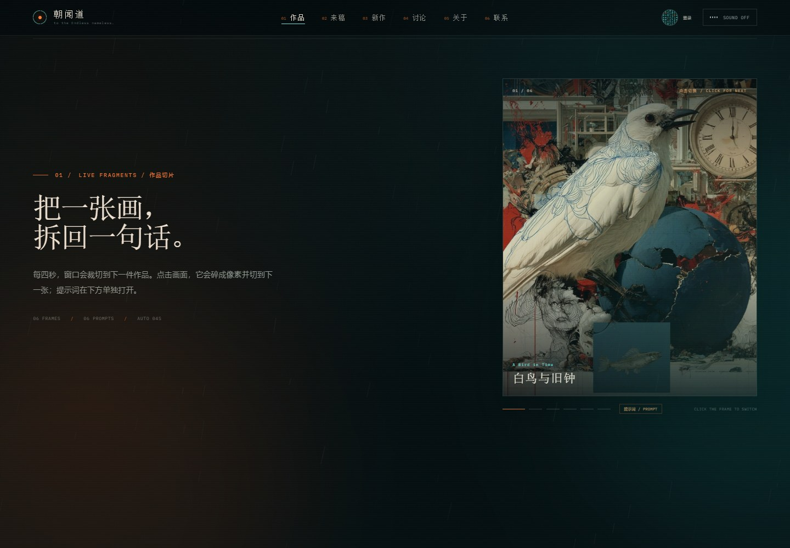
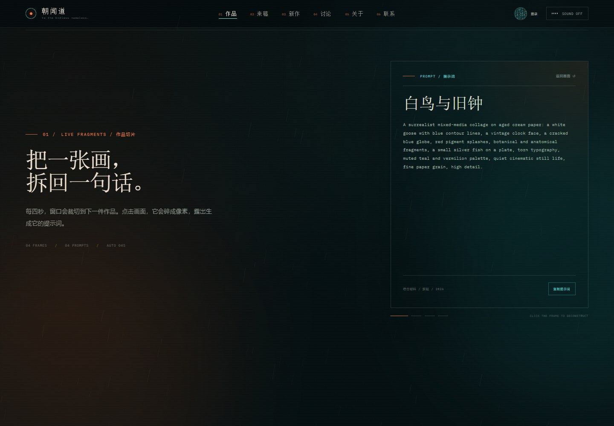
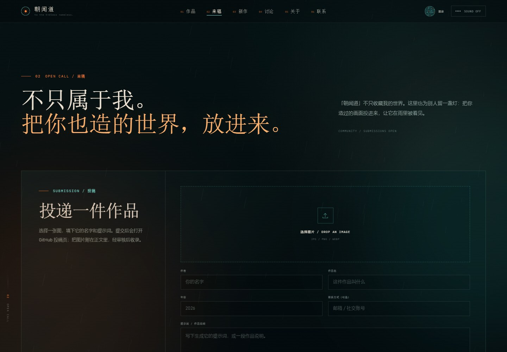
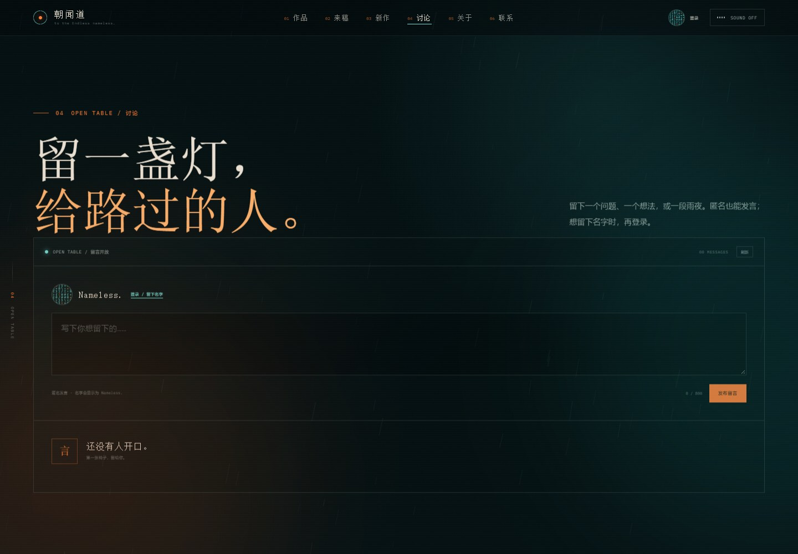
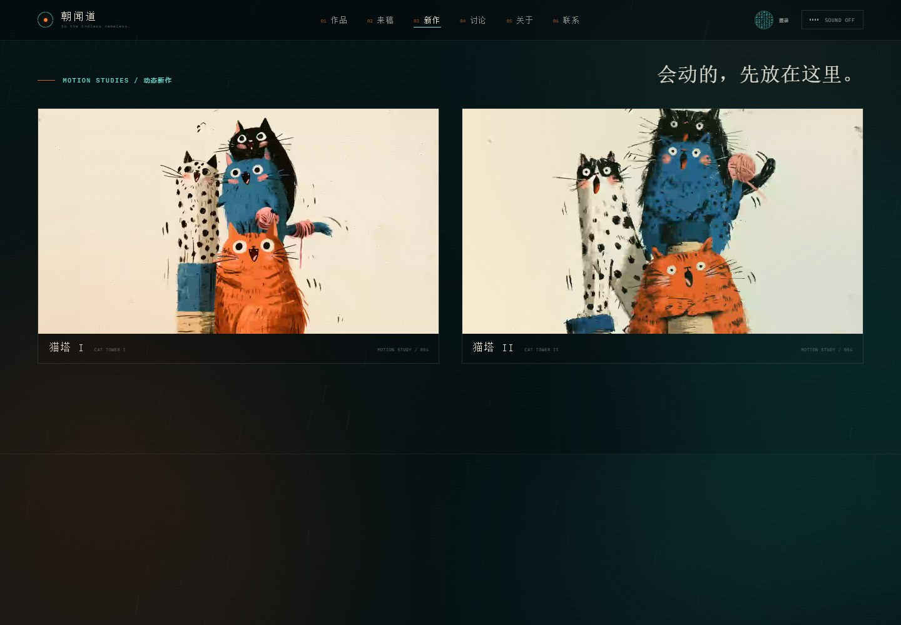

# 朝闻道 · ZHAOWENDAO

> to the Endless nameless.

Morin 的视觉档案馆。一个无框架、无构建步骤的静态站点：入场身份仪式、声音选择、作品切片、公开来稿、未来作品留白、匿名留言与个人账号。

- **正式地址**：<https://ink-neu.github.io/design/>
- **GitHub 仓库**：<https://github.com/ink-neu/design>
- **本地预览**：<http://127.0.0.1:4173>


| 入场验证 | 手机端 |
| --- | --- |
|  |  |

| 作品切片 | 像素拆解 / 提示词 |
| --- | --- |
|  |  |

| 来稿 | 留言 / 账号 |
| --- | --- |
|  |  |

| 动态新作 |  |
| --- | --- |
|  | 两段 5 秒循环动画，放在新作区底部。 |

---

## 现在怎么看

正式站由 GitHub Pages 自动构建，推送到 `main` 后会自动更新。

本地预览：

```powershell
cd chaowendao
python -m http.server 4173 --bind 127.0.0.1
```

然后打开 <http://127.0.0.1:4173>。不要直接双击 `index.html`；`file://` 会阻止字体和 Supabase 会话正常工作。

---

## 页面结构

导航共六项：

1. **作品 / WORKS** — 四件现有作品 + 1/3 屏「作品切片」（含两幅新的白鸟变体）。
2. **来稿 / OPEN CALL** — 别人的作品投稿与已收录来稿。
3. **新作 / FORTHCOMING** — 保留的空房间，底部新增两段动态新作。
4. **讨论 / OPEN TABLE** — Supabase 匿名留言与登录账号。
5. **关于 / ABOUT**
6. **联系 / CONTACT**

### 作品切片

作品区里有一个约占屏幕 1/3 的竖向窗口：

- 共 6 帧：四件原作品 + 两幅新的白鸟变体；
- 每 **4.2 秒**自动切到下一件作品，图片用 `object-fit: cover` 裁切；
- 点击画面，当前图片碎成像素方格，然后切到下一张；
- 图片下方有「提示词 / PROMPT」按钮，进入该图的提示词文字界面，可一键复制；
- 鼠标移到图片上，图片变亮，边框发光；
- 暂停/继续、切换标签页、离开视口时会自动停止轮播；
- 支持“减少动效”系统设置。

提示词写在 `site.config.js` 的 `works.items[].prompt` 和 `fragment.extraItems[].prompt`。

### 新作 / 动态新作

「新作」区保留原来的空画框，并在底部放入两段 5 秒循环动画：

- `assets/video/cats-tower-1.mp4`
- `assets/video/cats-tower-2.mp4`

视频自动播放、静音、循环，进入视口才播放；点击画面可以暂停/继续。

### 来稿 / Open Call

这是一个 **GitHub Issues 投稿 + 审核** 流程，不需要额外服务器：

1. 访客在来稿区选择一张图、填写作者、作品名、年份、提示词；
2. 点击「在 GitHub 继续投稿」，打开仓库的新 Issue 页面；
3. 把图片拖入 Issue 正文并提交；
4. 馆主在 GitHub 给这条 Issue 加上 **`accepted`** 标签；
5. 站点读取带 `submission` + `accepted` 标签的 Issue，自动显示在「已收录」里。

标签：

- `submission` — 所有投稿
- `accepted` — 审核通过、在站内展示

图片不会上传到本站服务器，只在本地预览；正式图片保存在 GitHub Issue 附件里。

### 讨论 / 账号

讨论区使用 **Supabase**，不是 GitHub Issues：

- 匿名访客也可以留言；默认名字固定为 **Nameless.**
- 默认头像是圆形代码头像，根据匿名 ID 生成；
- 想留下自己的名字时，点「登录」；
- 登录方式：邮箱魔法链接（无需密码）；
- 登录后可以修改名字、代码头像样式，性别可选填；
- 匿名身份升级为邮箱账号时，原来的留言会保留（同一个 Supabase 用户 ID）。

Supabase 项目：

- Project URL：`https://roclabcyhwcseswvonrx.supabase.co`
- 前端使用 publishable key，配置在 `site.config.js` 的 `auth` 字段；
- 数据表：`profiles`、`comments`；
- RLS 已启用：公开读，用户只能写自己的资料和留言；
- Auth Site URL / Redirect URL：`https://ink-neu.github.io/design/`

> publishable key 可以公开；不要提交 `service_role` key。

---

## 内容状态

- 四件作品的标题、年份、类别、描述和提示词目前是按画面代填的**工作版**。
- 两幅新的白鸟变体已经加入首屏轮播与作品切片，但正式标题/说明仍可替换。
- 两段猫塔动画已经加入新作区，正式标题与说明仍可替换。
- 关于页、邮箱 `hello@morin.art`、社交链接仍为占位内容。
- 新作区按你的要求保持为空。
- 来稿区已开放，但还没有收到第一件投稿。
- 讨论区已开放，还没有第一条留言。

---

## 替换素材

所有内容集中在 **`site.config.js`**。

### 作品图片

| 作品 | 文件 | 用途 |
| --- | --- | --- |
| 白鸟与旧钟 | `assets/img/work-bird.jpg` | 入场图 + 首屏 + 作品 01 + 切片 |
| INK | `assets/img/work-ink.jpg` | 首屏 + 作品 02 + 切片 |
| 门 | `assets/img/work-door.jpg` | 首屏 + 作品 03 + 联系区背景 + 切片 |
| 绘者 | `assets/img/work-painter.jpg` | 首屏 + 作品 04 + 关于页 + 切片 |

作品字段：

```js
{
  id: "a-bird-in-time",
  title: "白鸟与旧钟",
  en: "A Bird in Time",
  year: "2026",
  category: "综合材料 / 拼贴",
  description: "……",
  prompt: "The prompt shown when the image is clicked…",
  image: "assets/img/work-bird.jpg",
  alt: "……",
  ratio: "16 / 10",
  position: "center"
}
```

### 改名、邮箱、社交链接

```js
contact: {
  email: "hello@morin.art",
  socials: [
    { label: "Instagram", href: "https://instagram.com/…" }
  ]
}
```

### 账号头像

代码头像的配色在 `auth.avatarStyles`，新增一项即可出现在账号编辑里：

```js
{ id: "rain", label: "雨", bg: "#041b1d", fg: "#71ded6", accent: "#ff7b32" }
```

---

## 发布前还要做

- [ ] 替换四件作品的正式标题、年份、职责、描述与提示词。
- [ ] 替换关于页介绍、照片、邮箱和社交链接。
- [ ] 确认 Weird Inside 音乐的公开播放授权。
- [ ] 在 GitHub 仓库创建 `submission` 与 `accepted` 标签。
- [ ] 用真实邮箱测试一次魔法链接登录，确认 Supabase Auth 的 Site URL / Redirect URL 生效。
- [ ] 决定是否把讨论区留言/账号的隐私说明写进页面。

---

## 部署

### GitHub Pages（当前）

- 仓库：`ink-neu/design`
- 分支：`main` / root
- 正式地址：<https://ink-neu.github.io/design/>
- `.nojekyll` 已启用，推送后自动构建

### 其他平台

也可以部署到 Vercel、Netlify 或 Cloudflare Pages。所有站点资源路径都是相对路径。

---

## 文件结构

```text
chaowendao/
├─ index.html              页面结构
├─ styles.css              全站样式 / 动效 / 响应式
├─ app.js                  入场、轮播、音乐、作品切片、来稿
├─ community.js             Supabase 账号、代码头像、留言
├─ site.config.js           ★ 所有内容 / Supabase 配置
├─ assets/
│  ├─ img/                  作品图、分享图、噪点与图标
│  ├─ video/                两段新作动画
│  ├─ audio/                四首 m4a 背景音乐
│  ├─ fonts/                字体与 OFL 授权
│  └─ vendor/supabase.js    浏览器端 Supabase SDK
├─ docs/                    README 预览图
├─ serve.mjs                本地静态服务器
└─ preview.cmd              双击启动本地预览
```

---

## 技术备注

- 无框架、无构建步骤；图标全部内联 SVG。
- 音乐使用原生 `<audio>` + Media Session；首屏不预载音频。
- 作品切片使用 DOM 像素瓦片做解散动画；点击切片切换下一张，提示词通过独立按钮打开。
- 来稿使用 GitHub Issues 作为无需数据库的投稿箱 + 审核队列。
- 账号与留言使用 Supabase Auth + Postgres RLS；匿名登录会创建 `Nameless.` 资料。
- 入场验证是前端仪式，不是密码保护；讨论区与来稿才是真实公网数据。
