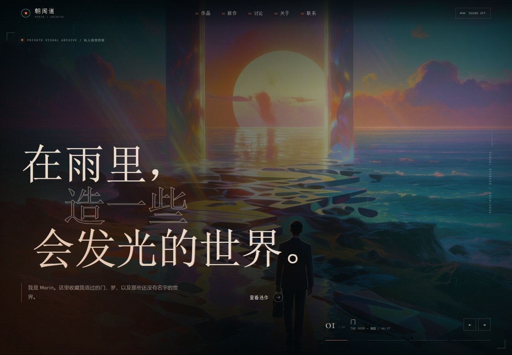
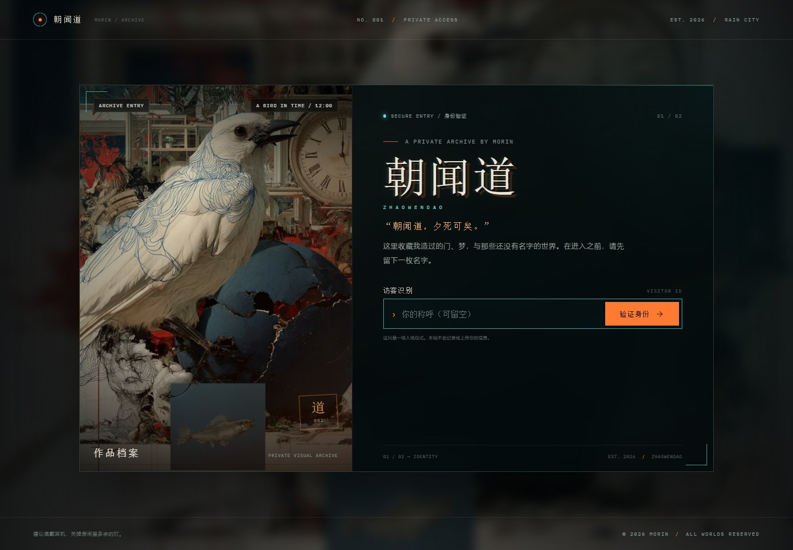
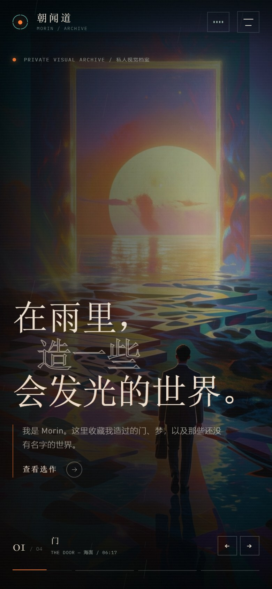
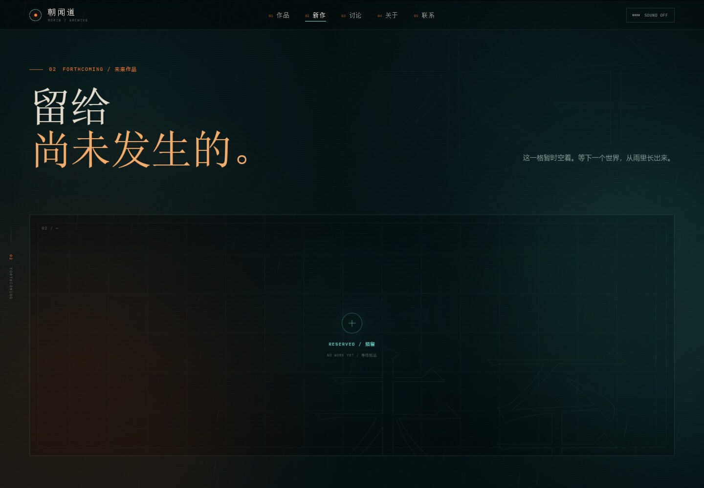
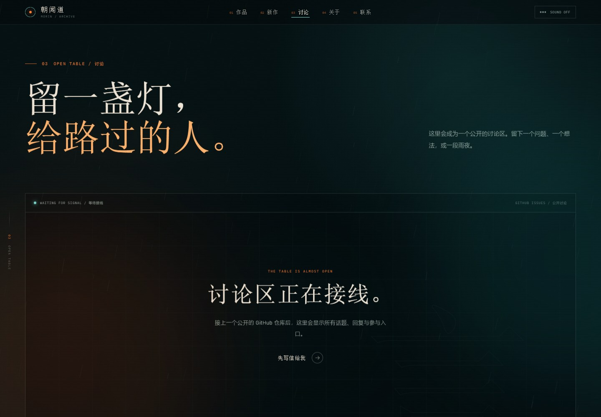

# 朝闻道 · ZHAOWENDAO

> 在雨里，造一些会发光的世界。

Morin 的私人视觉档案馆。一个无框架、无构建步骤的静态个人网站，包含入场身份仪式、声音选择、四首循环配乐、3 秒作品轮播、未来作品留白、GitHub 讨论区与全屏作品档案。



| 入场验证 | 手机端 |
| --- | --- |
|  |  |

| 新作 · 留白 | 讨论 · 待接线 |
| --- | --- |
|  |  |

---

## 现在就可以看

当前预览地址：**http://127.0.0.1:4173**

以后本地预览：

1. 双击项目根目录里的 **`preview.cmd`**；或
2. 在终端运行：

```powershell
cd chaowendao
python -m http.server 4173 --bind 127.0.0.1
```

然后打开 <http://127.0.0.1:4173>。

> 请通过本地服务器访问，不要直接双击 `index.html`。页面本身仍能打开，但 `file://` 会阻止自定义字体加载，排版会退化为系统字体。

---

## 当前页面结构

导航顺序：

1. **作品 / WORKS** — 四件现有作品
2. **新作 / FORTHCOMING** — 专门留给未来作品的空房间，目前保持为空
3. **讨论 / OPEN TABLE** — 类似论坛的公开讨论区
4. **关于 / ABOUT**
5. **联系 / CONTACT**

当前已经接好：

- **入场验证**：鸟的拼贴作品作为入口画面，「朝闻道」站名、身份输入、扫描、ACCESS GRANTED 动画。
- **声音选择**：验证后选择「带声音进入」或「安静地进入」。
- **四首背景音乐**：Weird Inside 的 *Manifold*、*Who Knows?*、*No More Heroes*、*Just Ask*，按顺序循环；右上角随时开关。
- **3 秒轮播**：4 张真实作品图自动轮换，可手动切换；打开作品详情或切换到后台时暂停。
- **作品档案**：白鸟、INK、门、绘者四件作品进入非对称作品网格和全屏详情。
- **新作留白**：独立的 FORTHCOMING 区块，目前只有一个「预留 / RESERVED」的空画框。
- **讨论区结构**：已经完成论坛样式与 GitHub Issues 读取逻辑；填入一个公开仓库后即可显示真实话题并允许跳转发帖。
- **联系标题**：大标题下现在是「雨是公平的，会下给富人，也会下给穷人。」
- **移动端**：五栏导航、菜单、入口、轮播、作品网格与详情均单独适配。

> 入场验证是「仪式性验证」，不收集、不上传数据，也不是密码保护。需要真实验证码 / 年龄门禁时可以继续加。

---

## 内容状态

你说明的 **第 4、5 项先空着**，所以目前：

- 四件作品的标题（白鸟与旧钟 / INK / 门 / 绘者）、年份、类别和描述，都是按画面内容代填的**工作版**。
- 关于页文案、事实、邮箱 `hello@morin.art`、社交链接仍为占位内容。
- 新作区按你的要求保持为空。
- 讨论区还没有接入 GitHub 仓库，因此现在显示「讨论区正在接线」的待接线状态，不会显示假帖子。

---

## 讨论区如何真正开放

讨论区使用 **GitHub Issues** 作为轻量论坛：网站读取公开话题列表，点击任意话题会进入 GitHub 查看和回复，点「发起话题」会打开已配置仓库的新 Issue 页面。这样不需要额外数据库或服务器，也不会产生假的本地留言。

### 步骤

1. 在你的 GitHub 账号下新建一个**公开仓库**，例如 `chaowendao-forum`；保持 Issues 开启。
2. 打开 `site.config.js`，填写：

```js
discussion: {
  // ...
  github: {
    owner: "你的 GitHub 用户名",
    repo: "chaowendao-forum",
    label: "",     // 留空 = 读取全部 Issues；也可以建一个 "discussion" 标签并填进来
    limit: 6
  }
}
```

3. 重新部署或在本地刷新。
4. 讨论区会变成真实话题列表，顶部出现「发起话题」，每个话题显示作者、回复数与更新时间。

也可以直接把仓库链接发我，我来填好并重新部署。

> 如果希望回复也完全留在站内、而不是跳到 GitHub，就需要数据库和登录后端；目前这版选择的是无后端、真实可用的 GitHub 方案。

---

## 素材替换

所有内容集中在 **`site.config.js`**，不需要改 HTML。

### 作品图片与文字

四件作品在 `works.items`，同时被首屏轮播和作品网格复用：

| 作品 | 文件 | 当前用途 |
| --- | --- | --- |
| 白鸟与旧钟 | `assets/img/work-bird.jpg` | 入场图 + 首屏 + 作品 01 |
| INK | `assets/img/work-ink.jpg` | 首屏 + 作品 02 |
| 门 | `assets/img/work-door.jpg` | 首屏第一张 + 作品 03 + 联系区背景 |
| 绘者 | `assets/img/work-painter.jpg` | 首屏 + 作品 04 + 关于页 |

项目字段：

```js
{
  id: "a-bird-in-time",
  title: "白鸟与旧钟",
  en: "A Bird in Time",
  year: "2026",
  category: "综合材料 / 拼贴",
  description: "……",
  image: "assets/img/work-bird.jpg",
  alt: "图片描述",
  ratio: "16 / 10",
  position: "center"
}
```

- 项目数量不固定，新增/删除会自动排布。
- `ratio` 可混用 `16 / 10`、`1 / 1`、`4 / 5`、`5 / 4`，保留当前非对称节奏。

### 未来作品区

`future` 配置控制新作区的文案：

```js
future: {
  eyebrow: "FORTHCOMING / 未来作品",
  title: "留给\n尚未发生的。",
  lede: "这一格暂时空着。等下一个世界，从雨里长出来。",
  frameLabel: "RESERVED / 预留",
  frameMeta: "NO WORK YET / 等待抵达",
  ghost: "未至"
}
```

目前没有假作品。以后有新作时，可以把 `future` 区替换为新的作品网格，或者直接把作品加入 `works.items`，把这一区继续留空。

### 背景音乐

四首歌已从原始 320 kbps MP3 压缩为适合网页播放的 **AAC / m4a（112 kbps，约 11.3 MB 合计）**，放在：

```text
assets/audio/
├─ 01-manifold.m4a
├─ 02-who-knows.m4a
├─ 03-no-more-heroes.m4a
└─ 04-just-ask.m4a
```

`site.config.js` 中：

```js
audio: {
  volume: 0.3,
  tracks: [
    { file: "assets/audio/01-manifold.m4a", title: "Manifold", artist: "Weird Inside" },
    { file: "assets/audio/02-who-knows.m4a", title: "Who Knows?", artist: "Weird Inside" },
    { file: "assets/audio/03-no-more-heroes.m4a", title: "No More Heroes", artist: "Weird Inside" },
    { file: "assets/audio/04-just-ask.m4a", title: "Just Ask", artist: "Weird Inside" }
  ]
}
```

- 按数组顺序播放，每首结束后淡出并切到下一首，最后循环回第一首。
- 想换顺序、删歌或只留一首，直接改数组。
- 建议上传 **m4a / mp3 / ogg**；不要放未压缩 WAV。
- 右上角开关的 `aria-label` 会显示当前曲名。

### 关于 / 联系

- 关于页图片目前是 `work-painter.jpg`，修改 `about.image` 即可替换成个人照 / 工作照。
- 联系区背景目前是 `work-door.jpg`，在 `index.html` 的 `.contact__bg` 中。
- 联系标题与大标题下一行：

```js
contact: {
  title: ["下一次，", "在雨里见。"],
  statement: ["雨是公平的，", "会下给富人，也会下给穷人。"],
  // ...
}
```

- 修改 `contact.email`、`about.body`、`about.facts`。
- `contact.socials` 默认为空，填写后才显示。

### 发布前一定要改

- [ ] `contact.email`：当前是占位邮箱 `hello@morin.art`。
- [ ] `meta.siteUrl`：填写正式域名，分享卡片与 canonical 才能正确指向。
- [ ] `meta.title` / `meta.description`。
- [ ] 四件作品的正式标题、年份、职责、描述。
- [ ] 关于页个人介绍、事实与照片。
- [ ] 社交链接、合作状态。
- [ ] 讨论区的 GitHub 仓库。
- [ ] 确认 Weird Inside 音乐的公开播放授权。

---

## 部署

纯静态站，不需要构建或后端。

### Vercel

- Framework Preset: **Other**
- Build Command: 留空
- Output Directory: `.`

### GitHub Pages

把文件夹内容推到仓库根目录，Settings → Pages → Deploy from a branch → `main` / root。

### Netlify Drop

把整个 `chaowendao` 文件夹拖到 <https://app.netlify.com/drop>。

### Cloudflare Pages

- Framework preset: **None**
- Build command: 留空
- Build output directory: `/`

所有路径都是相对路径，可以放在域名根目录或子目录。

---

## 文件结构

```text
chaowendao/
├─ index.html               页面结构
├─ styles.css               全站样式 / 动效 / 响应式
├─ app.js                   入场、轮播、音乐、讨论区、作品详情
├─ site.config.js           ★ 所有内容与 GitHub 讨论配置
├─ serve.mjs                本地静态服务器
├─ preview.cmd              双击启动本地预览
├─ docs/                    README 预览图
├─ assets/
│  ├─ img/                  作品图、分享图、噪点与图标
│  ├─ audio/                四首 m4a 背景音乐
│  └─ fonts/                英文字体与 OFL 授权
└─ README.md
```

字体：Cormorant Garamond 与 IBM Plex Mono，SIL Open Font License，授权全文在 `assets/fonts/`。

---

## 技术备注

- 无框架、无依赖、无构建步骤；图标全部内联 SVG。
- 音乐使用原生 `<audio>` + Media Session 元数据；首屏不预载音频，用户选择声音后才开始加载。
- 讨论区通过 GitHub REST API 读取公开 Issues，不在站内保存任何访客数据。
- 遵守 `prefers-reduced-motion`：减少动效时关闭自动轮播和大部分装饰动画。
- 作品详情使用原生 `<dialog>`，支持 Esc 关闭与键盘左右切换。
- 没有后端，因此入场验证只存在于浏览器前端，不能作为真正的权限控制。
